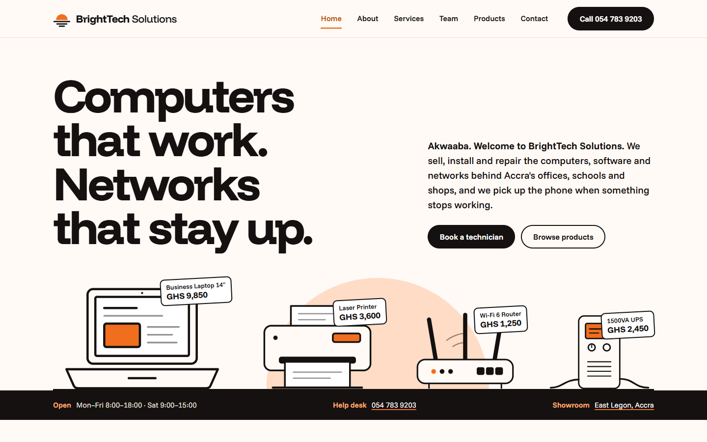

# BrightTech Solutions — company website

A responsive, multi-page website for **BrightTech Solutions**, a (fictional) Accra company that sells
and supports computer hardware, software, networking and IT support.

Built for the Web Technologies practical assignment (Level 300, first semester, Knutsford University)
using **HTML and CSS only**: no JavaScript, no Bootstrap or other frameworks, and no external
libraries. Every file the site uses is in this repository; the one outside item is the embedded Google Map on the Contact page.

**Live site:** https://plinxxdarkseid.github.io/brighttech-solutions/



---

## Group members

| No. | Name | Index number | Role at BrightTech | Built |
|---|---|---|---|---|
| 1 | Edze Prince Daniel | 26104018 | Managing Director | Home page, header and navigation, page transitions, colour scheme and typography |
| 2 | Anang Queenstar Atswei | 26104029 | Head of Networking & Security | About us and Services pages, history timeline, support plans table, responsive layout |
| 3 | Atta Bansah Defred | 26104026 | Lead Software Engineer | Our team and Products pages, product filter, quote builder, product drawings |
| 4 | Caleb Apemenyor Tawiah | 26103238 | Customer Support Manager | Contact page and form, thank-you and not-found pages, video and audio, footer, GitHub Pages |

---

## Requirements checklist

| # | Requirement | Where it is |
|---|---|---|
| 1 | **Home page**: company name and logo, welcome message, navigation menu, relevant image | `index.html`: logo and name in the header; "Welcome to BrightTech Solutions" beside the headline; a menu linking to all six pages; product drawings on the shelf |
| 2 | **About us**: history, mission and vision, headings and paragraphs | `about.html`: company story, a dated history timeline, mission and vision statements |
| 3 | **Services**: at least four, as lists/sections/cards, with icons | `services.html`: four services with icons and lists, "How a repair works" steps, support plans table |
| 4 | **Our team**: at least four members with name, position, photograph, biography | `team.html`: four members |
| 5 | **Products**: at least five with name, image, description, price | `products.html`: eight products, with a CSS-only category filter and quote builder |
| 6 | **Contact form**: name, email, phone, subject, message, submit | `contact.html`: validated form that opens `thanks.html` |
| 7 | **HTML elements**: at least five of the listed ten | All ten are used (see below) |
| 8 | **CSS styling**: colour scheme, navigation, layout, buttons, tables, forms, images, spacing, fonts, responsive | `style.css`, one stylesheet for every page, organised in 17 numbered sections |

### All ten HTML elements

| Element | Used for | Page |
|---|---|---|
| Ordered list `<ol>` | Company history timeline; "How a repair works" steps; breadcrumbs | `about.html`, `services.html` |
| Unordered list `<ul>` | What each service includes; navigation; product grid; footer links | every page |
| Table `<table>` | Support plans comparison; opening hours | `services.html`, `contact.html` |
| Hyperlinks `<a>` | Navigation, buttons, footer | every page |
| Images `` | Logo, product drawings, service icons, team photographs | every page |
| Video `<video>` | "BrightTech in half a minute" film, with English captions (`<track>`) | `index.html` |
| Audio `<audio>` | Spoken help desk message with hours, location and number | `contact.html` |
| Email link `mailto:` | Contact details; every product's "Order by email" link pre-fills the subject | `contact.html`, `products.html`, footer |
| Telephone link `tel:` | Header button, contact details, footer | every page |
| Google Maps link | Showroom address, plus an embedded map (`<iframe>`) | `index.html`, `contact.html`, footer |

---

## Interactive without JavaScript

| Feature | How it works |
|---|---|
| Quote builder | Tick products and the total adds itself up. `:has()` turns each ticked checkbox into a price variable, `calc()` adds them, and a CSS `counter()` prints the answer. Section 11 of `style.css` explains it line by line. |
| Product filter | Radio buttons, and `:has()` hides products outside the chosen category. Products animate back in when they reappear. |
| Page transitions | `@view-transition` fades one page into the next while the header stays still. Browsers without it simply open the next page. |
| Current page in the menu | Each page marks its own link with `aria-current="page"`, and CSS underlines it. |
| Mobile menu | A hidden checkbox and its `<label>` (the menu button). `.menu-toggle:checked ~ .site-nav` shows the links. |
| Form validation | `required`, `type="email"`, `pattern` and `minlength` in HTML, and `:user-invalid` in CSS shows each error only after the visitor has typed. |
| FAQ accordion | Native `<details>` and `<summary>`, with a plus sign drawn in CSS. |
| Subject suggestions | `<datalist>` suggests subjects while still allowing free text. |
| Scroll effects | A reading progress bar (`animation-timeline: scroll()`) and cards that rise into view (`animation-timeline: view()`), only where the browser supports them. |
| Animations | Products land on the shelf and price tags swing in on load, all switched off for visitors who prefer reduced motion. |

## Design

Warm white pages and black ink, with orange kept as an accent. Our first version covered the whole
screen in bright orange, which tired the eyes, so large areas now use two very soft tints and strong
orange only fills small things: icons, dots and the sun in the logo. The half-sun on the horizon from
the logo returns behind each page title.

## Accessibility and quality

- Semantic structure: `header`, `nav`, `main`, `section`, `article`, `aside`, `address`, `figure`, `footer`.
- One `h1` on every page, with headings in order.
- Every form field has a `<label>`; every image has `alt` text (decorative icons use `alt=""`).
- Skip link, visible keyboard focus everywhere, colour contrast checked for projectors.
- Every page passes the W3C HTML checker with no errors.
- Tested at eight widths from 1920px to 360px with no sideways scrolling, and with nothing but the map loaded from
  outside this repository.

---

## Folder structure

```
index.html          home page
about.html          about us
services.html       services, repair steps, support plans
team.html           our team
products.html       products, filter, quote builder
contact.html        contact form, details, audio, FAQ
thanks.html         page shown after a form is sent
404.html            page shown by GitHub Pages for a wrong address
style.css           all styling, for every page
favicon.svg         browser tab icon
fonts/              Funnel Display and Funnel Sans (SIL Open Font License, see fonts/OFL.txt)
images/             logo, product drawings, service icons, team photographs, link preview
media/              brand film (MP4), its captions (VTT) and poster, help desk message (MP3)
docs/               screenshots for this README
```

## Viewing it

- **Online:** open the live site link above (GitHub Pages).
- **On your computer:** open `index.html` in a browser. Everything works except the film captions and
  the fade between pages, which browsers only allow from a web server, so use the live site to see those.

## Credits

- Illustrations, icons and logo: original SVG drawings made for this site.
- Brand film: animated in HTML and CSS, rendered to MP4; voice-over and help desk message
  recorded with neural text-to-speech voices.
- Fonts: Funnel Display and Funnel Sans, © The Funnel Project Authors, SIL Open Font License 1.1.
- BrightTech Solutions, its prices and address are fictional, created for this assignment.
